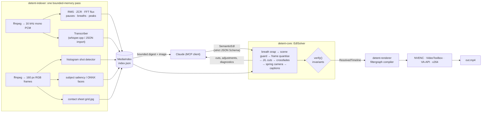

# detent

A local-first media indexer, Semantic EDL solver and MCP video engine, written in Rust.

An LLM decides **what** to keep and in which order. A deterministic solver decides **exactly where** each cut lands and **how** the camera and audio move. The model never writes an FFmpeg filter, a frame number or a pixel coordinate.

## The problem

AI-edited video tends to look amateurish for mechanical reasons, not editorial ones. When a model cuts on `.srt` timestamps:

- cuts land mid-breath or clip the first phoneme of a word (subtitle timing is ±200 ms at best);
- an in-point 60 ms before a camera change produces a 2-frame flash of the previous shot;
- every splice is a hard audio cut, so jump cuts are obvious and waveforms click;
- "zoom in here" becomes linear `zoompan` ramps that start and stop abruptly and jitter on integer pixel steps.

Human editors cut on audio transients, breath gaps and picture changes, and they ease camera moves. detent extracts that telemetry once, exposes a compact summary to the model over the [Model Context Protocol](https://modelcontextprotocol.io), accepts only high-level editorial intent back, and resolves it with signal processing and closed-form physics.

## Architecture



| Crate | Responsibility | I/O |
|---|---|---|
| `detent-core` | `MediaIndex`, `SemanticEdl` schema, streaming DSP, spring camera, caption chunker, `EdlSolver`, `ResolvedTimeline` + invariant checker | none (pure) |
| `detent-indexer` | Decoder traits, FFmpeg streaming decoders, shot detection, saliency, contact sheets, `whisper` / `onnx` adapters | FFmpeg child processes |
| `detent-renderer` | Encoder discovery, filtergraph compiler, render execution, stream-copy preview | FFmpeg child processes |
| `detent-mcp` | `rmcp` stdio server with four tools | stdio |
| `detent-cli` | `detent index · solve · render · mcp · schema · encoders · bench` | filesystem |

## Quick start

Requires Rust ≥ 1.88 and FFmpeg/ffprobe on `PATH` (or set `DETENT_FFMPEG` / `DETENT_FFPROBE`).

```bash
cargo install --path crates/detent-cli
```

```bash
detent index talk.mp4 --transcript talk.words.json
```

```bash
detent solve talk.mp4.detent/index.json examples/edl.json
```

```bash
detent render talk.mp4.detent/timeline.json -o short.mp4 --preview
```

`detent index` writes `index.json` and `grid.jpg` into `talk.mp4.detent/`. The transcript is optional but strongly recommended: detent imports word-level JSON in its own format or the WhisperX / faster-whisper `segments[].words[]` layout. You can also build with `--features whisper` and pass `--whisper-model ggml-base.en.bin`.

`detent solve` prints every cut it resolved, every automatic adjustment, and every request it could not honour. Here is real output for [`examples/edl.json`](examples/edl.json) against the 10-minute benchmark file, which has no transcript:

```text
$ detent solve bench.mp4.detent/index.json examples/edl.json
  ✗ /captions: captions requested but the index has no transcript
Error: EDL rejected with 1 issue(s)

$ detent solve bench.mp4.detent/index.json edl_without_captions.json
solved 3 clip(s) → 1080x1920@30.000 (30.00s), 3 adjustment(s)
  clip 0: requested 312400-319900 ms → video 312400-319900 ms (frames 9372-9597), at 0 ms
  clip 1: requested 41200-52800 ms → video 41200-52800 ms (frames 1236-1584), at 7500 ms
  clip 2: requested 330100-341000 ms → video 330100-341000 ms (frames 9903-10230), at 19100 ms
  [info] no_valley: no breath/silence valley within ±120 ms of the In-point at 312400 ms
  …
  [warn] scene_collision: In-point at 330100 ms is 100 ms from a shot change at 330000 ms, but moving it would cut speech; a brief flash may be visible
  [warn] jl_downgraded: AutoJCut after clip 0 downgraded to Hard: no speech-free 150-220 ms window on both sides of the splice
```

`detent schema edl` prints the JSON Schema the model is held to.

## Claude Code / Claude Desktop (MCP)

```bash
claude mcp add detent -- detent mcp
```

For Claude Desktop, add this to `claude_desktop_config.json`:

```json
{
  "mcpServers": {
    "detent": { "command": "detent", "args": ["mcp"] }
  }
}
```

| Tool | Input | Returns |
|---|---|---|
| `index_media` | `path`, optional `transcript_json`, `out_dir` | `index_path`, a bounded **digest** (phrases with ms timings, natural cut windows, emphasis peaks, shot changes, a 240-point loudness curve), and the contact sheet as an image |
| `inspect_keyframes` | `index_path`, `start_ms`, `end_ms`, grid size | a timestamped JPEG grid for that range |
| `solve_and_validate_edl` | `index_path`, `edl` (`SemanticEdl`) | `timeline_path`, frame-exact cut list, adjustments, diagnostics; or **all** validation issues as JSON pointers |
| `render_timeline` | `resolved_timeline_path`, `output_path`, `quality`, `mode`, `encoder` | encoder used, frames, fps, realtime factor |

The digest is sized by `DigestLimits`, so a two-hour file costs the model about as many tokens as its transcript.

### The Semantic EDL

`deny_unknown_fields` is set on every struct, so a hallucinated `"zoompan": "..."` or `"x": 120` fails at the boundary. Validation collects every issue in one pass and reports each with a JSON pointer, so the model can fix them all in a single round-trip.

```json
{
  "clips": [
    { "start_ms": 312400, "end_ms": 319900, "hook_score": 0.92,
      "editorial_note": "Counter-intuitive claim; strongest opening line." }
  ],
  "motion_cues":       [ { "clip": 0, "preset": "SpringPunchIn", "intensity": "Strong" } ],
  "audio_transitions": [ { "after_clip": 0, "kind": "AutoJCut", "offset_ms": 220 } ],
  "captions":          { "style": "BoldPop", "position": "Lower" },
  "output":            { "aspect": "Vertical9x16", "height": 1920 }
}
```

Motion presets are `None`, `SpringPunchIn`, `SmoothTrackSubject` and `SlowCreep`. Transitions are `Hard`, `AutoJCut` and `AutoLCut` (offset 150–300 ms). Caption styles are `BoldPop`, `Minimal` and `Karaoke`.

## The solver: math and invariants

All timeline arithmetic is integer: microseconds plus frame indices over an exact rational frame rate (`30000/1001` stays exact). Floating point is used only for camera geometry.

**1. Breath snapping (±120 ms).** Each requested in/out point moves to the best candidate inside the tolerance window. For a silence, that is its quietest 10 ms hop (the valley). For a breath, it is the breath's leading edge, so the breath is kept or dropped whole and never clipped. A candidate is rejected if a transcript word lies within 20 ms of it. If no pause qualifies and the cut lands inside a word, it moves to the nearest inter-word gap.

**2. Scene-collision guard (150 ms).** A cut within 150 ms of a shot boundary moves onto that boundary's exact frame, removing 1–4 frame flashes, but only when the audio between the two points contains no speech. Otherwise the solver keeps the cut and reports a `scene_collision` warning.

**3. Frame quantisation.** The cut rounds to the nearest frame boundary, or to the other neighbour if the nearest one would cross into a word.

**4. J/L cuts.** For splice `k` with signed offset `oₖ` (`>0` J, audio leads; `<0` L, audio lags), clip `i`'s audio is

```text
a_in(i)  = v_in(i)  − o(i−1)
a_out(i) = v_out(i) − o(i)
```

Lip sync is preserved inside every clip, and Σ audio = Σ video telescopically. The solver tries the requested offset, then shorter ones in 10 ms steps down to 150 ms, and accepts the first offset for which both the audio *removed* and the audio *inserted* are speech-free (or inside detected pauses when there is no transcript). If none qualifies, the splice is downgraded to `Hard` with a diagnostic.

**5. Micro-crossfades (15–25 ms).** Every splice gets an equal-power crossfade (`qsin`/`qsin`, so sin² + cos² = 1). It is centred on the audio cut by extending both sides by `c/2` of real source audio. That makes `Σ audio − Σ crossfades = Σ video` hold **exactly** in microseconds, so the A/V offset never accumulates.

**6. Critically damped spring camera.** Crop centre and zoom follow `x'' + 2ζω₀x' + ω₀²x = ω₀²·target` with `ζ = 1`, integrated in closed form per frame rather than with Euler steps:

```text
x(t) = target + (c₁ + c₂t)·e^(−ω₀t),   c₁ = x₀ − target,   c₂ = v₀ + ω₀c₁
```

This is unconditionally stable and independent of frame rate. The impulse response `ω₀²·t·e^(−ω₀t)` is non-negative, so a spring starting at rest is a convex combination of past targets. It cannot overshoot, and it never leaves the hull of its targets. Centre targets are clamped to the region where a zoom-1 window fits, and zoom ≥ 1 only widens that region, so every crop window lies inside the source frame by construction. Punch-ins trigger 80 ms before vocal excitement peaks (spectral flux combined with loudness z-score) and release after a hold.

**7. Path compression and FFmpeg expressions.** Per-frame windows are compressed with Ramer–Douglas–Peucker (L∞ error ≤ 0.25 source px) and emitted as hinge sums, `f(t) = v₀ + k₀t + Σ Δkⱼ·max(0, t − tⱼ)`. FFmpeg's expression evaluator silently fails beyond about 100 terms in a flat sum, so the terms are emitted as a balanced tree with depth O(log n); this is tested with 1,500-term paths. As defence in depth, the renderer fails if the encoded frame count differs from the timeline's.

**8. Syntactic captions.** Words are split into phrases at pauses ≥ 300 ms, sentence ends and clip boundaries. Each phrase is segmented by a Knuth–Plass-style dynamic program with a lexicographic cost: overflowing blocks first, then blocks ending on a function word ("the", "of", "and", …), then soft balance and clause preferences. The same ranking picks the two-line break. The result is compiled to `.ass` and burned in with libass.

`ResolvedTimeline::verify()` checks these invariants. The solver runs it before returning, the renderer runs it on load (timelines are files and can be edited by hand), and the property tests assert it:

- frame-aligned, positive-length video ranges inside the source;
- monotonic output timestamps, with `duration = Σ segments`;
- audio inside the source, and `Σ audio − Σ crossfades = Σ video` exactly;
- crossfades in `[0, 25 ms]` and never longer than either neighbour;
- J/L offsets equal to 0 or within `[150, 300] ms`;
- crop windows non-empty, inside the source and at the output aspect;
- caption blocks non-overlapping and monotonic.

## Engineering properties

- **Bounded memory.** PCM is streamed in 64 KiB blocks and frames one at a time from FFmpeg child processes. The DSP analyzer holds one FFT window, and the envelope costs 1.2 KB per media second. FFmpeg stderr is drained on a thread into a 4 KiB tail, so a chatty decoder cannot deadlock the pipe. The renderer seeks one input per segment instead of `split`ting a decoded stream, so reordered clips never queue raw frames.
- **No panics in libraries.** Library crates deny `unwrap`, `expect` and `panic` outside tests and forbid `unsafe`. Errors are `thiserror` enums; `anyhow` is used only in the two binaries.
- **Strict LLM boundary.** The `schemars` JSON Schema is generated from the same types that deserialize the input, with `deny_unknown_fields` everywhere.
- **Determinism.** The same index and EDL produce a bit-identical timeline (a property test). `serde_json` runs with `float_roundtrip`; a test caught a 1-ULP drift when a timeline was saved and reloaded without it.
- **Hardware encoding is verified, not assumed.** Each compiled-in encoder must pass a two-frame test encode before it is selected. The order is NVENC → VideoToolbox → VA-API → libx264.

## Benchmarks

Measured on this development machine: AMD Zen 4 (family 25, model 97), 12 threads, NVIDIA RTX 5060 Ti, Windows 11, Rust 1.98.1 (release, `lto = "thin"`), FFmpeg 2026-09 git build. The real-file rows use a generated 10-minute 1080p30 H.264/AAC file (moving test pattern, hue-shift scene changes every 15 s, syllable-modulated audio with pauses).

Reproduce with:

```bash
detent bench --input your_file.mp4
```

| Stage | Workload | Result |
|---|---|---|
| Audio DSP (RMS, ZCR, 512-pt FFT flux, pauses, peaks) | 600 s mono f32 @ 16 kHz (38.4 MB), 1 thread | **373 MB/s**, **5,835x realtime** |
| `EdlSolver::solve` (all stages, incl. springs + captions) | 4 clips / 715 frames | **89 µs** median |
| `EdlSolver::solve` | 12 clips / 2,324 frames | **299 µs** median |
| `EdlSolver::solve` | 32 clips / 6,278 frames | **854 µs** median |
| Caption DP chunker | 1,000 words | **230 µs** median |
| Index real file (decode → DSP + shots + saliency + contact sheet) | 600 s 1920×1080@30 | **53x realtime** (11.3 s wall, 18,000 frames) |
| Render 9:16 1080×1920, spring camera, crossfades | 60 s output, `h264_nvenc` | **7.9x realtime** (237 fps) |
| Render 9:16 1080×1920, spring camera, crossfades | 60 s output, `libx264` | **5.2x realtime** (155 fps) |
| Preview (keyframe-aligned stream copy) | 60 s output | **467x realtime** |

Criterion micro-benchmarks, run in isolation:

```bash
cargo bench -p detent-core -p detent-indexer
```

| Benchmark | Time (median) | Throughput |
|---|---|---|
| `dsp/envelope+pauses/60s@16k` | 9.87 ms | 371 MiB/s |
| `dsp/envelope+pauses/600s@16k` | 98.8 ms | 371 MiB/s |
| `solver/solve/4_clips` | 89.0 µs | |
| `solver/solve/12_clips` | 313 µs | |
| `solver/solve/32_clips` | 976 µs | |
| `captions/chunk_1000_words` | 257 µs | |
| `vision/shot_detector_160x90` (300 frames) | 15.6 ms | 19.2 k frames/s |
| `vision/saliency_160x90` (300 frames) | 49.1 ms | 6.1 k frames/s |

Indexing is bound by H.264 decoding in FFmpeg; the analysis itself (DSP, histograms, saliency on 160 px frames) is a small fraction of the wall time. Rendering with zoom is bound by the per-frame bicubic `scale` that implements sub-pixel zoom on the CPU, not by the encoder.

## Testing

```bash
cargo test --workspace
```

| Suite | What it covers |
|---|---|
| `detent-core` unit tests | DSP (−3 dBFS sine, chunk-size invariance, silence/breath placement, peak spacing), rational time, EDL strictness and schema, spring closed form, RDP, captions, `.ass` escaping |
| `detent-core` property tests | spring: no overshoot, target-hull containment, monotone tracking; camera: bounded crops and exact aspect; RDP error bound; captions: order, size and weak-ending rules; **solver**: every invariant above for random indices/EDLs (5 frame rates, any aspect, ± transcript/audio), bounded cut movement, determinism |
| `detent-indexer` | ffprobe parsing (rotation, cover art, NTSC rates), shot detector, saliency tracking, chunked ASR windowing, contact sheets; **FFmpeg integration**: a synthetic MP4 is cut at exactly frame 75 and its silent gap is found within 50 ms |
| `detent-renderer` | encoder discovery parsing, filtergraph golden tests, hinge-expression property test; **end-to-end**: index → solve (punch-in, tracking, L-cut, captions) → render has **exactly** the solved frame count, with audio within 50 ms of video; stream-copy preview; tampered timelines rejected |
| `detent-mcp` | spawns the real binary and speaks JSON-RPC over stdio: initialize, tools/list, a hallucinated field rejected, index → validation issues → solve → render → inspect |

Tests that need FFmpeg skip with a message when it is not installed. CI runs `fmt`, `clippy -D warnings`, tests on Linux (with FFmpeg), macOS and Windows, a one-shot run of every benchmark, and a Linux job that compiles the `whisper` and `onnx` adapters.

## Feature flags (`detent-indexer`)

| Feature | Default | Effect |
|---|---|---|
| `dsp` | yes | Pure-Rust audio analysis |
| `ffmpeg-cli` | yes | Streaming decoders over an `ffmpeg` child process |
| `whisper` | no | `whisper-rs` (whisper.cpp) word-level ASR, streamed in ≤ 28 s windows cut at the quietest point |
| `onnx` | no | `ort` UltraFace face detector, using ONNX Runtime loaded dynamically (`ORT_DYLIB_PATH`) |

## Limitations

- The default subject tracker is a heuristic (motion energy, YCbCr skin prior and centre bias). It works for single-subject footage. Use `onnx` for real face detection.
- The shot detector finds hard cuts, not dissolves or fades.
- `whisper-rs` does not build with the `x86_64-pc-windows-gnu` toolchain (its build script passes the MSVC-only `/utf-8` flag to MinGW). Use MSVC or Linux, or import a transcript JSON.
- The renderer opens one FFmpeg input per segment (two with audio). That keeps memory bounded, but very long EDLs (hundreds of clips) are better rendered in batches.

## License

MIT
