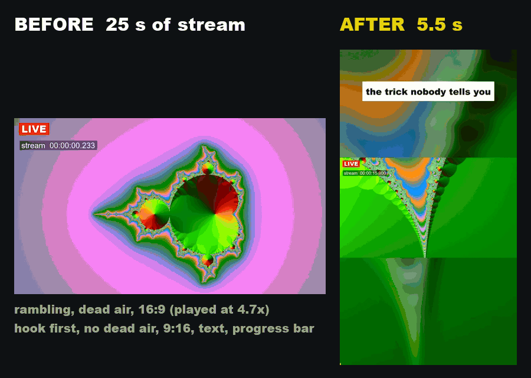
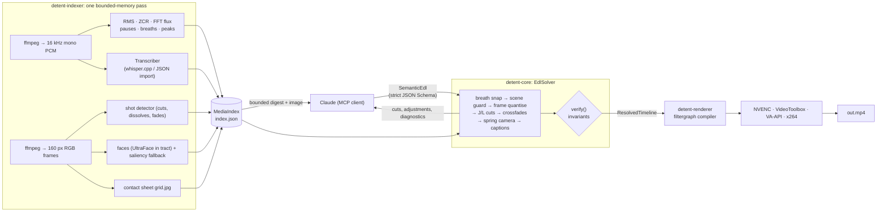

# detent

**Turn a 2-hour stream, podcast or talking-head video into tight vertical clips by talking to Claude. No timeline, no cloud upload, and no cuts that land mid-word.**

[](https://github.com/TYFALY/detent/actions/workflows/ci.yml)




<sub>The demo footage is generated (a fractal zoom and a text-to-speech voice), so it can be shared freely. The edit is one `detent solve` + `detent render` of [this EDL](examples/demo.json).</sub>

detent is a local-first media indexer, Semantic EDL solver and [MCP](https://modelcontextprotocol.io) video engine, written in Rust.

An LLM decides **what** to keep and in which order. A deterministic solver decides **exactly where** each cut lands and **how** the camera and audio move. The model never writes an FFmpeg filter, a frame number or a pixel coordinate.

```text
you:    "Find the best 45 seconds in podcast.mp4 and make it a TikTok."
claude: index_media → picks the hook → solve_and_validate_edl → render_timeline
detent: 5 cuts snapped into breath gaps, 0 inside words, dead air removed,
        9:16 spring camera, word-by-word captions, voice at -14 LUFS → short.mp4
```

### What you get out of the box

| Short-form craft | How detent does it |
|---|---|
| Cut the preamble, open on the hook | The model scores every clip's `hook_score`; the solver warns when a stronger hook is buried |
| Kill dead air (> 0.2 s) | `tighten` splits clips at every silence or breath longer than the threshold and never touches a word |
| Seamless conversation cuts | Automatic J/L-cuts (150-300 ms): the audio cut moves when both sides have a pause, the picture cut moves when only one side does or when no face is on screen, plus 15-25 ms equal-power crossfades on every splice. They also work into and out of slow-mo clips and clips from files with no sound |
| No flash frames | Cuts within 150 ms of a camera change move onto it exactly |
| Pattern interrupts | `SpringPunchIn` zooms (1.06-1.15x) land just before vocal emphasis peaks with a critically damped spring: no overshoot, no jitter |
| Open with motion | `opening_pop`: 100% → 108% smoothstep scale-in over the first 0.4 s |
| 3-second hook banner | `headline` plus `headline_duration_ms: 3000`; a white box pinned at the top |
| Captions that hold attention | 2-5 word blocks split by a line-breaking DP (never "THE HIGHEST IT / WAS"), `BoldPop`, `Karaoke`, or one word at a time with `WordBounce` (yellow) or `WordPunch` (white, slams in from 130%), keywords colour-coded with `word_colors`, inside platform safe zones |
| Show the receipts (B-roll) | `inserts`: images or video clips pop over the A-roll as yellow-bordered cards (50% → 105% → 100% in 0.16 s), or cut to full-frame cutaways while the voice keeps playing |
| Sound design | `sound`: synthesised whoosh or click on every cut between clips and on cutaways (not on `tighten` jump cuts), a pop on every card, and your music track normalised, laid ~20 dB under the voice and ducked while someone talks |
| Signpost the steps | `chapters`: a persistent yellow label ("3. Make a Bootable USB") that switches at the clip you name |
| The right layout | `Crop` for talking heads with face tracking (a built-in face detector, no download); `FitBlur` / `FitBlurTall` for gameplay, screen shares and facecam streams |
| Intentional transitions | Clean cuts by default; `Flash` (4 white frames) for kills, shocks and beat drops |
| Phone-ready finish | `grade: MobilePop` (+8% contrast, +5% saturation, light sharpen) and `audio_mix: VoiceForward` (rumble cut, 3:1 compression, -14 LUFS, -3 dBTP peaks) |
| Cut across a whole footage folder | `detent index footage/` indexes every video; each clip names its `source`, so one edit mixes many files. Different resolutions and frame rates are converted, and files with no sound track play silence |
| Never show stream lag | The indexer finds stalls three ways: gaps in the frame timestamps (captures that store nothing while the stream stalls), repeated frames between moving ones, and runs of bit-identical frames inside live camera noise (captures that duplicate frames while stalling; a camera never produces two identical frames). The solver cuts them out of every clip. A stall inside a still picture is reported as `still_lag_ms` and left in, because nobody can see it. Files whose timestamp gaps cover more than half their length (screen recorders that store frames only on change) are judged by the picture alone |
| Text with no speech behind it | `texts`: "show this from here to here" lines for music trailers and silent product footage. `headline` and `chapters` no longer need a transcript either |
| Slow-mo replays | `speed` from 0.25x to 4x per clip, with pitch-kept audio: repeat the payoff at 0.5x right after it plays |
| Dark footage, progress bar, logo | `output.exposure: Auto` lifts only the dark clips (measured per second while indexing); `output.progress_bar` draws a filling bar; `logo` places a watermark |
| Upload limits | `--max-size-mb 9.5` (Instagram's web uploader rejects files over 10 MB): the bitrate is computed from the length and the encode is redone lower if the file still comes out too big |
| Campaign rules | `detent check rules.json` tests the edit, the file and the caption against a paid campaign's rules (approved caption lines word for word, allowed hashtags and mentions, banned words on screen, no music, official footage only, 9:16, size) and prints the steps only a person can do |

Everything runs on your machine with FFmpeg, local whisper.cpp and a face detector built into the binary. Hardware encoding (NVENC, VideoToolbox, VA-API) is detected and verified automatically.

If detent saves you an afternoon of scrubbing timelines, a ⭐ helps other people find it.

## The problem

AI-edited video tends to look amateurish for mechanical reasons, not editorial ones. When a model cuts on `.srt` timestamps:

- cuts land mid-breath or clip the first phoneme of a word (subtitle timing is ±200 ms at best);
- an in-point 60 ms before a camera change produces a 2-frame flash of the previous shot;
- every splice is a hard audio cut, so jump cuts are obvious and waveforms click;
- "zoom in here" becomes linear `zoompan` ramps that start and stop abruptly and jitter on integer pixel steps.

Human editors cut on audio transients, breath gaps and picture changes, and they ease camera moves. detent extracts that telemetry once, exposes a compact summary to the model over the [Model Context Protocol](https://modelcontextprotocol.io), accepts only high-level editorial intent back, and resolves it with signal processing and closed-form physics.

## Architecture



| Crate | Responsibility | I/O |
|---|---|---|
| `detent-core` | `MediaIndex`, `SemanticEdl` schema, streaming DSP, spring camera, caption chunker, `EdlSolver`, `ResolvedTimeline` + invariant checker | none (pure) |
| `detent-indexer` | Decoder traits, FFmpeg streaming decoders, shot detection, face detection (pure Rust) with saliency fallback, freeze and timestamp-gap detection, contact sheets, `whisper` / `onnx` adapters | FFmpeg child processes |
| `detent-renderer` | Encoder discovery, filtergraph compiler, render execution (EDLs over 32 clips render in lossless FFV1 batches, then one join pass applies the cross-batch crossfades, grade and captions), stream-copy preview | FFmpeg child processes |
| `detent-mcp` | `rmcp` stdio server with five tools | stdio |
| `detent-cli` | `detent index · solve · render · check · mcp · schema · encoders · bench` | filesystem |

## Quick start

Requires Rust ≥ 1.91 and FFmpeg/ffprobe on `PATH` (or set `DETENT_FFMPEG` / `DETENT_FFPROBE`).

### Without ML models

Everything below is pure Rust plus FFmpeg. Subject framing uses the built-in face detector (the 1.2 MB UltraFace model is compiled into the binary and run by [tract](https://github.com/sonos/tract), so there is nothing to download), and word timings come from a transcript you import.

```bash
cargo install --path crates/detent-cli
```

```bash
detent index talk.mp4 --transcript talk.words.json
```

```bash
detent solve talk.mp4.detent/index.json examples/edl.json
```

```bash
detent render talk.mp4.detent/timeline.json -o short.mp4 --preview
```

`detent index` writes `index.json` and `grid.jpg` into `talk.mp4.detent/`. The transcript can be detent's own `[{word,start_ms,end_ms,confidence}]` JSON or the WhisperX / faster-whisper `segments[].words[]` layout. A transcript is optional, but strongly recommended, because the solver protects words.

### With local ML models (no C++ toolchain needed)

1. **Speech.** Download a prebuilt `whisper-cli` from the [whisper.cpp releases](https://github.com/ggml-org/whisper.cpp/releases) and a ggml model such as `ggml-base.en.bin`.
2. **Faces (optional).** Faces are detected out of the box. To run the same model through ONNX Runtime instead (for example with a GPU provider), build with `--features onnx` and download [ONNX Runtime](https://github.com/microsoft/onnxruntime/releases) 1.24+ and `version-RFB-320.onnx`.
3. Point detent at them:

```bash
export DETENT_WHISPER_CLI=/path/to/whisper-cli DETENT_WHISPER_MODEL=/path/to/ggml-base.en.bin
```

```bash
export ORT_DYLIB_PATH=/path/to/libonnxruntime.so DETENT_FACE_MODEL=/path/to/version-RFB-320.onnx
```

```bash
detent index talk.mp4
```

The same variables configure the MCP server. With CMake, a C++ compiler and libclang, `--features whisper` links whisper.cpp natively instead of using the subprocess. This works on Linux, macOS, Windows MSVC and Windows MinGW; the MinGW fixes live in [`vendor/`](vendor/README.md).

`detent solve` prints every cut it resolved, every automatic adjustment, and every request it could not honour. Here is real output from the edit described in *Real-footage results* below:

```text
solved 5 clip(s) → 1080x1920@60.000 (45.18s), 7 adjustment(s)
  clip 0: requested 60-15240 ms → video 50-15183 ms (frames 3-911), at 0 ms
  clip 1: requested 16603-22376 ms → video 16550-22383 ms (frames 993-1343), at 15133 ms
  clip 2: requested 47538-56707 ms → video 47533-56717 ms (frames 2852-3403), at 20967 ms
  clip 3: requested 78378-86663 ms → video 78383-86667 ms (frames 4703-5200), at 30150 ms
  clip 4: requested 99012-105784 ms → video 99017-105767 ms (frames 5941-6346), at 38433 ms
  [warn] jl_downgraded: AutoJCut after clip 0 downgraded to Hard: speech is continuous on both sides of the splice (no speech-free 150-200 ms window); a micro-crossfade is still applied
```

`detent schema edl` prints the JSON Schema the model is held to.

### A folder of footage (paid clipping campaigns)

Campaigns hand out a folder of official clips, not one long video. Index the folder once, then point clips at files with `source` (0 is the index you pass first, 1 the first `--source`, and so on); [`examples/multisource.json`](examples/multisource.json) mixes three files with on-screen text and a slow-mo replay.

```bash
detent index footage/
```

```bash
detent solve "footage/a.mp4.detent/index.json" examples/multisource.json -s "footage/b.mp4.detent/index.json" -s "footage/c.mp4.detent/index.json" -o timeline.json
```

```bash
detent render timeline.json -o short.mp4 --max-size-mb 9.5
```

```bash
detent check examples/campaign.json --timeline timeline.json --video short.mp4 --caption "Acme just showed off the Widget @acme #ad"
```

`detent check` exits with status 2 when a rule fails, so it can gate an upload script. `detent schema campaign` prints the rules format; [`examples/campaign.json`](examples/campaign.json) is a complete example.

## Claude Code / Claude Desktop (MCP)

```bash
claude mcp add detent -- detent mcp
```

For Claude Desktop, add this to `claude_desktop_config.json`:

```json
{
  "mcpServers": {
    "detent": { "command": "detent", "args": ["mcp"] }
  }
}
```

| Tool | Input | Returns |
|---|---|---|
| `index_media` | `path`, optional `transcript_json`, `whisper_model`, `language`, `out_dir` | `index_path`, a bounded **digest** (sentence-level phrases with ms timings, natural cut windows, emphasis peaks, shot changes, a 240-point loudness curve, and a `framing_hint` such as `PipFacecam`), and the contact sheet as an image |
| `inspect_keyframes` | `index_path`, `start_ms`, `end_ms`, grid size | a timestamped JPEG grid for that range |
| `solve_and_validate_edl` | `index_path`, optional `extra_index_paths` (clip `source` 1, 2, …), `edl` (`SemanticEdl`) | `timeline_path`, frame-exact cut list, adjustments, diagnostics; or **all** validation issues as JSON pointers |
| `render_timeline` | `resolved_timeline_path`, `output_path`, `quality`, `mode`, `encoder`, optional `max_size_mb` | encoder used, frames, fps, realtime factor, capped bitrate |
| `check_campaign` | `rules_path`, optional `timeline_path`, `video_path`, `caption` | pass / fail / skipped per rule, plus the manual reminders |

The digest is sized by `DigestLimits`, so a two-hour file costs the model about as many tokens as its transcript.

### The Semantic EDL

`deny_unknown_fields` is set on every struct, so a hallucinated `"zoompan": "..."` or `"x": 120` fails at the boundary. Validation collects every issue in one pass and reports each with a JSON pointer, so the model can fix them all in a single round-trip.

```json
{
  "clips": [
    { "start_ms": 312400, "end_ms": 319900, "hook_score": 0.92,
      "editorial_note": "Counter-intuitive claim; strongest opening line." }
  ],
  "motion_cues":       [ { "clip": 0, "preset": "SpringPunchIn", "intensity": "Strong" } ],
  "audio_transitions": [ { "after_clip": 0, "kind": "AutoJCut", "offset_ms": 220 } ],
  "video_transitions": [ { "after_clip": 0, "kind": "Flash" } ],
  "tighten":           { "max_silence_ms": 200 },
  "captions":          { "style": "BoldPop", "position": "Lower",
                         "grouping": { "min_words": 2, "max_words": 4, "max_chars": 24, "pause_break_ms": 300 } },
  "headline":          "The mistake ruining your audio",
  "headline_duration_ms": 3000,
  "highlight_words":   ["mistake"],
  "word_colors":       [ { "word": "audio", "color": "Red" } ],
  "chapters":          [ { "clip": 0, "text": "1. The mistake" } ],
  "sound":             { "cut_sfx": "Whoosh", "pop_sfx": "Pop", "sfx_db": -12,
                         "music": { "path": "bed.mp3", "volume_db": -20, "duck": true } },
  "inserts":           [ { "path": "waveform.png", "clip": 0, "offset_ms": 1500,
                           "duration_ms": 2500, "placement": "Upper" } ],
  "output":            { "aspect": "Vertical9x16", "height": 1920, "layout": "Crop",
                         "opening_pop": true, "grade": "MobilePop", "audio_mix": "VoiceForward" }
}
```

Motion presets are `None`, `SpringPunchIn`, `SmoothTrackSubject` and `SlowCreep`. Audio transitions are `Hard`, `AutoJCut` and `AutoLCut` (offset 150–300 ms); video transitions are `Cut` (default) and `Flash`. Caption styles are `BoldPop`, `Minimal`, `Karaoke`, `WordBounce` and `WordPunch`; `word_colors` takes `Red`, `Yellow`, `Green`, `Blue`, `Orange` or `Pink` and overrides the green of `highlight_words`. Inserts are PNG, JPEG or WebP images or MP4, MOV, WebM or MKV clips (played muted from their start, looping if short), placed as cards `Upper` (default), `Center` or `Lower` (scaled to fit 80% of the width and 32% of the height) or as a `Fullscreen` cutaway. `sound.cut_sfx` is `None`, `Whoosh` or `Click`, `pop_sfx` is `None` or `Pop`; the effects are generated by FFmpeg, so no sample files are needed. Music must be a track you have the rights to. The headline and chapters render with or without `captions`. `output.layout` is `Crop` (camera crops a 9:16 window; for talking heads), `FitBlur` (the full 16:9 frame over a blurred fill; for screen, gameplay and reaction footage, where cropping would discard the content) or `FitBlurTall` (a taller 4:5 window over the blur, for action near the centre).

Clips take an optional `source` (which indexed file; default 0) and `speed` (0.25–4, default 1; audio is time-stretched with `atempo`, pitch kept). `texts` entries show a line from `offset_ms` into `clip` for `duration_ms`, or until the end of `end_clip` (default: the same clip), at `Upper` (default), `Center` or `Lower`, styled `Bold` (white, heavy stroke, pops in), `Boxed` (black on white) or `Yellow`; a newline breaks the line. `drop_freezes` (default `true`) cuts frozen-picture stretches out of clips; with `false` the solver only warns. `output.exposure` is `None`, `Lift` (gamma 1.25 everywhere) or `Auto` (gamma up to 1.45 on clips whose mean luma is under 0.36). `output.progress_bar` adds a yellow bar along the bottom; `logo` takes an image `path`, a `placement` (`TopCenter`, `TopLeft`, `TopRight`, `BottomCenter`) and `width_pct` (10–60, default 28). The output raster and frame rate come from source 0; segments from other frame rates or speeds are retimed onto that clock with the frame count rounded on the cumulative output clock, so the total never drifts by more than half a frame.

`tighten` runs before the solver. It splits each clip at pauses longer than `max_silence_ms`, keeps 60 ms of room tone on each side, never cuts a pause that overlaps a transcript word and never leaves a piece shorter than 300 ms. Those internal edges are pinned exactly, because snapping them into the pause valley would put the silence back. Motion cues are copied onto every piece, and transitions stay on the splice between the clips you wrote.

## The solver: math and invariants

All timeline arithmetic is integer: microseconds plus frame indices over an exact rational frame rate (`30000/1001` stays exact). Floating point is used only for camera geometry.

**1. Breath snapping (±120 ms).** Each requested in/out point moves to the best candidate inside the tolerance window. For a silence, that is its quietest 10 ms hop (the valley). For a breath, it is the breath's leading edge, so the breath is kept or dropped whole and never clipped. A candidate is rejected if a transcript word lies within 20 ms of it. If no pause qualifies and the cut lands inside a word, it moves to the nearest inter-word gap.

**2. Scene-collision guard (150 ms).** A cut within 150 ms of a shot boundary moves onto that boundary's exact frame, removing 1–4 frame flashes, but only when the audio between the two points contains no speech. Otherwise the solver keeps the cut and reports a `scene_collision` warning.

**3. Frame quantisation.** The cut rounds to the nearest frame boundary, or to the other neighbour if the nearest one would cross into a word.

**4. J/L cuts.** For splice `k` with signed offset `oₖ` (`>0` J, audio leads; `<0` L, audio lags), clip `i`'s audio is

```text
a_in(i)  = v_in(i)  − o(i−1)
a_out(i) = v_out(i) − o(i)
```

Lip sync is preserved inside every clip, and Σ audio = Σ video telescopically. Offsets live on the output clock: a clip playing at speed `s` covers `o·s` of its own source, so a J-cut into a half-speed replay leads with half as much source audio and the sums still balance. The solver tries the requested offset, then shorter ones in 10 ms steps down to 150 ms, and accepts the first offset for which both the audio *removed* and the audio *inserted* are speech-free (or inside detected pauses when there is no transcript). A file with no sound track plays silence, so its side always qualifies. If none qualifies, it tries the **picture side**: the audio splice stays where breath snapping put it and the video splice moves instead (a J-cut holds the outgoing picture over the next clip's first words; an L-cut shows the incoming picture early). The extra frames must be inside one shot and must not show a mouth that disagrees with the sound: either nothing is said there, or nobody on screen is talking: the face detector saw no face (`faceless_ms`: a screen, gameplay, a B-roll shot, someone facing away) or every visible mouth stayed still (`lips_still_ms`: listeners while someone off screen speaks). Each face is aligned between scans on its eyes and nose first, so camera shake and nodding do not count as talking. So the picture can move even when speech is continuous on both sides, as long as no visible mouth moves in the frames that shift. A face counts as talking for 600 ms around each scan where its mouth moved, and a frozen frame counts as talking, so a listener's twitch can only cost a J/L cut, never a lip mismatch. When someone on screen *is* talking through the frames that would shift and speech runs on both sides, every shift would drop or leak a word or show lips that disagree with the sound, so the solver makes a hard cut with a micro-crossfade and says why in a `jl_downgraded` diagnostic. The same formula applies with the shifted video ranges, so no audio is removed or inserted. Moving the picture needs both clips at one frame rate and normal speed; moving the audio does not.

**5. Micro-crossfades (15–25 ms).** Every splice gets an equal-power crossfade (`qsin`/`qsin`, so sin² + cos² = 1). It is centred on the audio cut by extending both sides by `c/2` of real source audio. That makes `Σ audio − Σ crossfades = Σ video` hold **exactly** in microseconds, so the A/V offset never accumulates.

**6. Critically damped spring camera.** Crop centre and zoom follow `x'' + 2ζω₀x' + ω₀²x = ω₀²·target` with `ζ = 1`, integrated in closed form per frame rather than with Euler steps:

```text
x(t) = target + (c₁ + c₂t)·e^(−ω₀t),   c₁ = x₀ − target,   c₂ = v₀ + ω₀c₁
```

This is unconditionally stable and independent of frame rate. The impulse response `ω₀²·t·e^(−ω₀t)` is non-negative, so a spring starting at rest is a convex combination of past targets. It cannot overshoot, and it never leaves the hull of its targets. Centre targets are clamped to the region where a zoom-1 window fits, and zoom ≥ 1 only widens that region, so every crop window lies inside the source frame by construction. Punch-ins trigger 80 ms before vocal excitement peaks (spectral flux combined with loudness z-score) and release after a hold.

**7. Path compression and FFmpeg expressions.** Per-frame windows are compressed with Ramer–Douglas–Peucker (L∞ error ≤ 0.25 source px) and emitted as hinge sums, `f(t) = v₀ + k₀t + Σ Δkⱼ·max(0, t − tⱼ)`. FFmpeg's expression evaluator silently fails beyond about 100 terms in a flat sum, so the terms are emitted as a balanced tree with depth O(log n); this is tested with 1,500-term paths. As defence in depth, the renderer fails if the encoded frame count differs from the timeline's.

**8. Syntactic captions.** Words are split into phrases at pauses ≥ 300 ms, sentence ends and clip boundaries. Each phrase is segmented by a Knuth–Plass-style dynamic program with a lexicographic cost: overflowing blocks first, then blocks ending on a function word ("the", "of", "and", …), then soft balance and clause preferences. The same ranking picks the two-line break. The result is compiled to `.ass` and burned in with libass.

`ResolvedTimeline::verify()` checks these invariants. The solver runs it before returning, the renderer runs it on load (timelines are files and can be edited by hand), and the property tests assert it:

- frame-aligned, positive-length video ranges inside the source;
- monotonic output timestamps, with `duration = Σ segments`;
- every segment reads a source that exists, at a speed within `[0.25, 4]`;
- audio inside the source, and `Σ audio − Σ crossfades = Σ video` exactly (on the output clock; a speed-changed segment may round by 2 µs);
- crossfades in `[0, 25 ms]` and never longer than either neighbour;
- J/L offsets equal to 0 or within `[150, 300] ms`;
- crop windows non-empty, inside the source and at the output aspect;
- caption blocks non-overlapping and monotonic.

## Word re-timing

whisper.cpp's per-word timestamps tend to swallow pauses. In one test narration (46 s, 15 detected pauses), every one of the 15 pauses was covered by a stretched word, so the solver would have found nowhere safe to cut. `detent_core::align` fixes this in two steps:

1. A monotonic dynamic program matches each pause ≥ 200 ms to at most one word boundary. The cost is the distance from the boundary to the pause centre, minus a bonus when the preceding word ends in punctuation, or a fixed penalty for leaving the pause unmatched (a stop inside a word, a cough, music).
2. Within each speech island between matched pauses, the whisper times are mapped affinely onto the island's acoustic extent. Word order and relative durations are kept.

On that narration this left 0 of 15 pauses covered and turned 1 run-on "phrase" into the 10 real phrases. This pass runs only for raw ASR output; imported transcripts from forced aligners are left as they are.

## Real-footage results

The pipeline was tested end to end through the MCP tools on a real 8 min 41 s commentary video (AV1 1080p60, stereo AAC). It is a reaction-style upload: a small facecam over browser screenshots and price charts, with a fast talker over background audio. The model picked a five-clip, 45 s market-crash story with `SpringPunchIn` on emphasis and `FitBlur` framing.

| Stage | Result |
|---|---|
| `index_media` (AV1 decode → DSP, shots, UltraFace subjects, contact sheet, `whisper-cli` base.en ASR, word re-timing) | 521 s of media in **49.8 s (10.5x realtime)**: 1,632 words, 85 shots, 1,299 face boxes |
| `solve_and_validate_edl` | **< 10 ms**: 0 cuts inside words, 0 scene collisions (3 snapped onto the source's own cuts), 5 punch-ins |
| `render_timeline` (1080×1920@60, FitBlur, spring camera, captions, `h264_nvenc`) | 45.2 s output in **11.5 s (3.9x realtime, 236 fps)**; exactly 2,711 frames, audio and video both 45.183 s |
| Splice audit | largest sample jump at any splice is 0.02–0.55x the track's normal 99.9th percentile: no clicks |

The first attempt exposed every problem listed in the next section; each was fixed at the root with a regression test.

## Engineering & edge cases solved

- **Whisper timestamp drift (acoustic re-timing).** Raw whisper.cpp words stretch across the following silence; in a test narration they covered 15 of 15 pauses. A monotonic DP matches pauses to word boundaries, then each speech island is re-timed affinely. Result: 0 of 15 covered. See *Word re-timing*.
- **Cuts inside back-to-back words.** In fast speech whisper emits zero-gap words and there are no pauses, so the first real edit put 8 of 10 cuts mid-word. Cuts now snap to the nearer word edge (≤ 350 ms), refined to the quietest 10 ms hop within ±40 ms.
- **Flash frames vs. padded word edges.** The source's own edits sat 17–50 ms from sentence ends. The scene guard used to refuse those moves to protect the padded tail of an ASR word, which left a 1–3 frame flash. It now trims up to 60 ms of word edge, which is ASR uncertainty, never real speech.
- **FFmpeg expression depth limit.** FFmpeg silently drops frames once a flat sum exceeds about 100 terms. Camera paths compile to hinge sums in a balanced tree, O(log n) deep, tested at 1,500 terms. Renders also fail if the frame count differs from the timeline's.
- **Facecam insets.** UltraFace correctly found the streamer's face, but it was a 5%-wide picture-in-picture box in a corner, and tracking it would crop away the content. Boxes under 12% of frame width are treated as insets: they are not tracked, the digest reports `framing_hint: PipFacecam`, and the `FitBlur` layout shows the full frame.
- **Subject hysteresis in crowds.** One primary face is chosen by `confidence × √area`; another face replaces it only if it is 1.5x more prominent, so the camera does not hop between people (42 faces in a group photo).
- **Over-eager punch-ins.** Animated speech produced 1.6 "peaks" per second, so the camera zoomed almost constantly. Punch-ins now need a top-15% peak and respect a 1.5 s cooldown and a 3 s hold cap, at 1.06 / 1.10 / 1.15x for Subtle / Medium / Strong.
- **Caption line breaks.** Real speech produced "AT 3 / CENTS", "HIGH OF 26 / DOLLARS" and "THE HIGHEST IT / WAS". Numbers (digits and words), subject pronouns and determiners like "such" now bind to the next word.
- **Unreadable digests.** A fast talker produced one 8-minute "phrase". Phrases now also split at sentence ends and every 25 words: 195 phrases.

## Engineering properties

- **Bounded memory.** PCM is streamed in 64 KiB blocks and frames one at a time from FFmpeg child processes. The DSP analyzer holds one FFT window, and the envelope costs 1.2 KB per media second. FFmpeg stderr is drained on a thread into a 4 KiB tail, so a chatty decoder cannot deadlock the pipe. The renderer seeks one input per segment instead of `split`ting a decoded stream, so reordered clips never queue raw frames.
- **No panics in libraries.** Library crates deny `unwrap`, `expect` and `panic` outside tests and forbid `unsafe`. Errors are `thiserror` enums; `anyhow` is used only in the two binaries.
- **Strict LLM boundary.** The `schemars` JSON Schema is generated from the same types that deserialize the input, with `deny_unknown_fields` everywhere.
- **Determinism.** The same index and EDL produce a bit-identical timeline (a property test). `serde_json` runs with `float_roundtrip`; a test caught a 1-ULP drift when a timeline was saved and reloaded without it.
- **Hardware encoding is verified, not assumed.** Each compiled-in encoder must pass a two-frame test encode before it is selected. The order is NVENC → VideoToolbox → VA-API → libx264.

## Benchmarks

Measured on this development machine: AMD Zen 4 (family 25, model 97), 12 threads, NVIDIA RTX 5060 Ti, Windows 11, Rust 1.98.1 (release, `lto = "thin"`), FFmpeg 2026-09 git build. The real-file rows use a generated 10-minute 1080p30 H.264/AAC file (moving test pattern, hue-shift scene changes every 15 s, syllable-modulated audio with pauses).

Reproduce with:

```bash
detent bench --input your_file.mp4
```

| Stage | Workload | Result |
|---|---|---|
| Audio DSP (RMS, ZCR, 512-pt FFT flux, pauses, peaks) | 600 s mono f32 @ 16 kHz (38.4 MB), 1 thread | **373 MB/s**, **5,835x realtime** |
| `EdlSolver::solve` (all stages, incl. springs + captions) | 4 clips / 715 frames | **89 µs** median |
| `EdlSolver::solve` | 12 clips / 2,324 frames | **299 µs** median |
| `EdlSolver::solve` | 32 clips / 6,278 frames | **854 µs** median |
| Caption DP chunker | 1,000 words | **230 µs** median |
| Index real file (decode → DSP + shots + saliency + contact sheet) | 600 s 1920×1080@30 | **53x realtime** (11.3 s wall, 18,000 frames) |
| Render 9:16 1080×1920, spring camera, crossfades | 60 s output, `h264_nvenc` | **7.9x realtime** (237 fps) |
| Render 9:16 1080×1920, spring camera, crossfades | 60 s output, `libx264` | **5.2x realtime** (155 fps) |
| Preview (keyframe-aligned stream copy) | 60 s output | **467x realtime** |

Criterion micro-benchmarks, run in isolation:

```bash
cargo bench -p detent-core -p detent-indexer
```

| Benchmark | Time (median) | Throughput |
|---|---|---|
| `dsp/envelope+pauses/60s@16k` | 9.87 ms | 371 MiB/s |
| `dsp/envelope+pauses/600s@16k` | 98.8 ms | 371 MiB/s |
| `solver/solve/4_clips` | 89.0 µs | |
| `solver/solve/12_clips` | 313 µs | |
| `solver/solve/32_clips` | 976 µs | |
| `captions/chunk_1000_words` | 257 µs | |
| `vision/shot_detector_160x90` (300 frames, cuts + dissolves) | 17.8 ms | 16.8 k frames/s |
| `vision/saliency_160x90` (300 frames) | 39.7 ms | 7.6 k frames/s |

Indexing is bound by H.264 decoding in FFmpeg; the analysis itself (DSP, histograms, saliency on 160 px frames) is a small fraction of the wall time. Rendering with zoom is bound by the per-frame bicubic `scale` that implements sub-pixel zoom on the CPU, not by the encoder.

## Testing

```bash
cargo test --workspace
```

| Suite | What it covers |
|---|---|
| `detent-core` unit tests | DSP (−3 dBFS sine, chunk-size invariance, silence/breath placement, peak spacing), rational time, EDL strictness and schema, spring closed form, RDP, captions, `.ass` escaping |
| `detent-core` property tests | spring: no overshoot, target-hull containment, monotone tracking; camera: bounded crops and exact aspect; RDP error bound; captions: order, size and weak-ending rules; **solver**: every invariant above for random indices/EDLs (5 frame rates, any aspect, ± transcript/audio), bounded cut movement, determinism |
| `detent-indexer` | ffprobe parsing (rotation, cover art, NTSC rates), shot detector, saliency tracking (follows one of two people instead of the gap between them, and switches exactly once when the other starts moving), face tracking (a waving hand never pulls the camera off the face, one-scan false positives are ignored, a missed face holds then falls back to saliency, face-free stretches are recorded), freeze detection (picture repeats and frame-timestamp gaps, including a stall inside a still shot), **real photos** through the built-in detector (gated on `DETENT_FACE_IMAGES`), chunked ASR windowing, contact sheets, dissolve and fade-through-black detection (and no false hits on drift or slow pans); **FFmpeg integration**: a synthetic MP4 is cut at exactly frame 75 and its silent gap is found within 50 ms; a real `xfade` dissolve and `fadeblack` are each found once; **native whisper** transcribes synthesised speech (gated on `DETENT_WHISPER_MODEL`) |
| `detent-renderer` | encoder discovery parsing, filtergraph golden tests, hinge-expression property test; **end-to-end**: index → solve (punch-in, tracking, L-cut, captions) → render has **exactly** the solved frame count, with audio within 50 ms of video; stream-copy preview; tampered timelines rejected; **batched rendering** (1 and 3 segments per process) gives the same frame count and A/V length as a single pass |
| `detent-mcp` | spawns the real binary and speaks JSON-RPC over stdio: initialize, tools/list, a hallucinated field rejected, index → validation issues → solve → render → inspect |

Tests that need FFmpeg skip with a message when it is not installed. CI runs `fmt`, `clippy -D warnings`, tests on Linux (with FFmpeg), macOS and Windows, a one-shot run of every benchmark, a Linux job that compiles the `whisper` and `onnx` adapters, and Windows MSVC and MinGW jobs that build `whisper` (the MinGW job also links and runs the native whisper test).

## Feature flags (`detent-indexer`)

| Feature | Default | Effect |
|---|---|---|
| `dsp` | yes | Pure-Rust audio analysis |
| `ffmpeg-cli` | yes | Streaming decoders over an `ffmpeg` child process |
| `whisper` | no | Native `whisper-rs` (whisper.cpp) ASR, streamed in ≤ 28 s windows cut at the quietest point. Without it, `--whisper-model` runs a prebuilt `whisper-cli` subprocess instead |
| `faces` | yes | Built-in face detection: the UltraFace RFB-320 model (MIT, 1.2 MB) is embedded and run by the pure-Rust `tract` engine at ~25 ms per frame. Frames are letterboxed (no distortion), deduplicated with NMS, and one primary face is followed with hysteresis so the camera does not hop between people. A new face must be seen in two scans in a row before the camera moves to it, a missed face holds the framing for 1.5 s, and with nobody in shot the motion-saliency tracker takes over. Set `DETENT_SUBJECTS=saliency` to use the heuristic alone |
| `onnx` | no | The same UltraFace pipeline through `ort`, with ONNX Runtime loaded at run time (`ORT_DYLIB_PATH`). Set `DETENT_FACE_MODEL=version-RFB-320.onnx` to use it |

## Limitations

- Face detection runs on 320 px frames, so faces under roughly 1% of the frame width (a crowd far away) are not found; the saliency fallback then frames the motion. The built-in detector and ONNX Runtime find the same faces on the test photos (42 in a ~50-person group photo), checked by the gated `faces_photos` and `onnx_faces` tests.
- Mouth motion is judged on the same 320 px frames, so faces under 24 px tall are treated as talking. That only ever costs a picture-side J/L cut (the splice gets a hard cut with a micro-crossfade instead), never a lip mismatch.

## Contributing

Bug reports, footage that trips up the solver, and pull requests are welcome. See [CONTRIBUTING.md](CONTRIBUTING.md) for the dev setup and checks, and [SECURITY.md](SECURITY.md) for reporting vulnerabilities privately. Everyone taking part follows the [Code of Conduct](CODE_OF_CONDUCT.md).

## License

MIT
